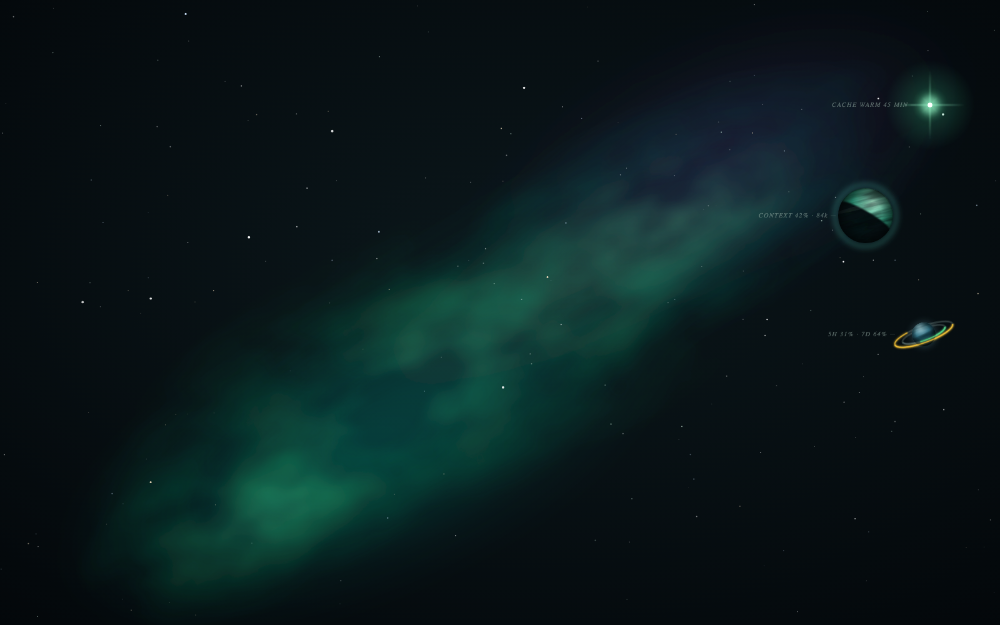

# nebula: a space look for the Claude desktop app



*The backdrop as the mod draws it (sample readings). In the app it sits behind the conversation, under a frosted glass layer.*

A dark palette, a green nebula and stars behind the conversation, and three live gauges drawn as sky objects:

- **star** = prompt cache (white-green while warm, orange in the last 5 minutes, dim red when cold)
- **large planet** = context window (the lit side grows as it fills)
- **ringed planet** = usage limits (inner ring 5-hour window, outer ring 7-day window)

It changes only the interface and uses zero tokens. The look draws in the desktop app only; the mobile app and the terminal show nothing.

## Install

At the prompt of a Claude Code terminal session:

```
/plugin install nebula --marketplace Tszos/claude-nebula
```

Answer `y` to add the marketplace, then pick a scope (user scope makes it load in every session).

From a shell:

```bash
claude plugin install nebula --marketplace Tszos/claude-nebula
```

In the desktop app, where `/plugin` does not run: click **+** next to the prompt box, then **Plugins**, **Add marketplace** with `Tszos/claude-nebula`, then **Add plugin**.

Start a new session and send one prompt: the look draws after the first prompt.

To try it once without installing: clone this repository and start `claude --plugin-dir /path/to/claude-nebula`.

## Cache lifetime

The cache star assumes a 60-minute prompt cache lifetime (a subscription). If your plan uses a different lifetime, change `TTL_MS` in `hooks/register.tsx`.

## License

MIT, see `LICENSE`.
